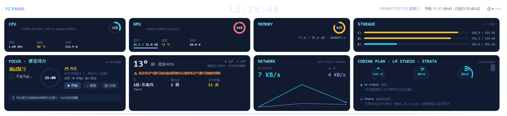
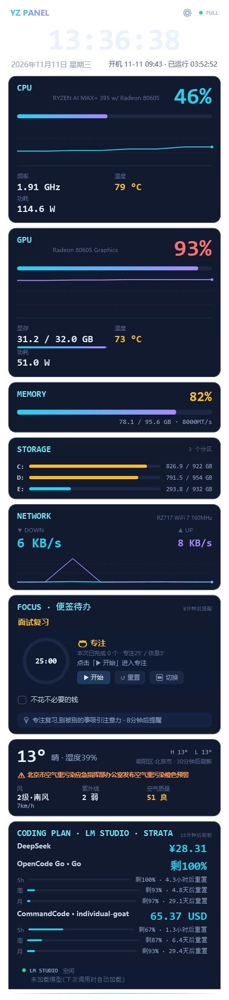

# PerfPanel — Windows 副屏硬件监控面板 (440×1920 / 1920×440)

[English](README.md) | **简体中文**

为竖长条/横长条 USB-C 副屏(Windows 视频扩展屏)设计的暗色科技风硬件监控面板,WPF 原生实现。竖版 440×1920 单列布局与横版 1920×440 双列布局共用同一套卡片组件,按副屏形状自动切换,也可手动指定。

## 运行效果图

横版 1920×440(实机截图,含自定义背景:设置 →「界面 / 自启」→ 背景选图并调不透明度):



竖版 440×1920(实机截图):



## 功能

- **时钟区**:实时时间、日期星期、开机时长
- **CPU**:占用率大数字 + 120 秒历史曲线、频率(LHM 核心时钟,读不到时用 WMI 有效频率,睿频可超标称)、温度、功耗、风扇转速(仅限主板 SuperIO 暴露风扇传感器的台式机;部分迷你主机/笔记本 EC 风扇读不到)
- **GPU**:占用率 + 历史曲线、显存占用(带进度条)、温度、功耗、风扇(核显无独立温度/风扇传感器时自动隐藏对应行;AMD 核显温度取 VR SoC)
- **便签 / 待办**:卡片显示一句话便签与待办清单,面板上点击整行即可勾选完成;按周期(15–90 分钟)轮换高亮专注提醒语(如"专注复习,别被别的事吸引注意力""记得查看复习计划看板");内容存 exe 旁 `notes.json`,设置(S)里编辑;横屏模式升级为左下大卡片(待办整行可点);内置**番茄钟**(进度环 + 专注/休息轮换计时,开始/暂停/重置/切换一键操作,到点系统提示音 + 完成横幅,时长可在设置改)
- **内存**:占用百分比 + 已用/总量,内存频率取 SMBIOS(`Win32_PhysicalMemory`,显示如 `· 8000MT/s`;混插多频率时取最慢一条)
- **磁盘**:每个固定分区(C:/D:/…,支持多块硬盘)一行用量条,取得到时标注所属物理盘的 SMART 温度(管理员模式,LibreHardwareMonitor 存储传感器);容量来自 WMI,免管理员也可用——竖屏独立卡;横屏放在右上格
- **网络**:实时上/下行速度 + 下行历史曲线,自动选择活动网卡
- **天气**:Open-Meteo 免费国际源(无需 key;可填高德 Key 切换国内稳定源),自动 IP 定位(可手动改 `weather.json`);再填和风 Host+Key 后天气主源切到和风——温度/天气现象/风/湿度/污染/UV/官方灾害预警 全国内口径
- **Coding Plan 额度**:DeepSeek 余额、智谱 GLM、火山方舟 Agent/Coding Plan、Xiaomi MiMo(按量付费余额 + Token Plan 套餐用量)、OpenCode Go(5h/周/月用量)、CommandCode(GOAT 套餐)剩余额度与重置倒计时
- **LM Studio 监控**:额度卡底部的 LM STUDIO 条实时显示本机 LM Studio 是否在线、加载了哪些模型、当前几个请求在跑,以及 prefill(prompt eval)/ decode(eval)速度(tok/s)——只显示 3 秒内的新数据,推理中沿用最近一次测得值(计时行仅在请求结束时打印);多模型加载时每 3 秒轮播一个模型,逐个展示各自的在飞数/预填充/速度——数据解析自 LM Studio 自身的服务日志,无需 API Token(新版 REST 接口要求 Bearer token 且明文不落盘)
- **Strata 监控**:额度卡底部的 STRATA 条显示本机 Strata 引擎在线/模型加载态、排队请求数和 prefill/decode 速度——推理中 decode 用服务端滚动平均值(标「·实时」,另有投机解码命中率),空闲显示「上次请求」的显式 prefill·decode 值;数据来自引擎本机 API(/health 免鉴权判在线与加载态,/status·/metrics 读速度),不读日志;引擎设置了 API Key 时在设置里粘贴,面板带 Bearer 头请求
- **智能降级**:无管理员权限时自动隐藏温度/功耗/风扇,右上角显示 `BASIC`;以管理员运行显示 `FULL`
- **自定义标题**:左上角 PERF PANEL 文字可在设置(S)→「界面」改成任意内容/emoji,输入即生效,留空 = 隐藏
- **背景自定义**:设置(S)→「界面」选一张本地图片作面板背景(支持 png/jpg/bmp/gif,自动复制到 exe 旁随程序走,源图移动/删除不影响),「背景图不透明度」与「卡片不透明度」两根滑杆即时可调——卡片调低后背景透出,文字仍保持不透明;未设置时维持默认深色底
- **横竖屏布局**:横版 1920×440 时钟居中,上排为 CPU/GPU/内存 圆环紧凑磁贴(用量一环了然)+STORAGE 磁盘卡,下排为紧凑半宽的 FOCUS 便签待办卡、天气、网络与额度卡(每个供应商一枚嵌套圆环横排对齐:5h/周/月由外到内,环心显示最紧张窗口的剩余%,余额类如 DeepSeek 显示常满环+金额);同列对(STORAGE/额度、GPU/天气)某方隐藏时另一方自动纵跨两行;`auto` 按副屏形状自动选,也可在设置、config.json 或命令行固定方向

## 运行

### 从源码快速启动(开发调试)

```bash
dotnet run --project src/PerfPanel                # 全屏模式(首次自动还原依赖并编译)
dotnet run --project src/PerfPanel -- --windowed  # 调试模式:主屏窗口化,无副屏时用
```

需 .NET SDK 8.0+(更高版本 SDK 亦可编译 net8.0 目标)。注意 `dotnet run` 是普通权限进程,右上角会显示 `BASIC`(无 CPU 温度/功耗/风扇);想看完整传感器,请用管理员终端执行,或先构建出 exe 再右键管理员运行。

### 运行构建产物

```
PerfPanel.exe            # 全屏模式:自动定位 440×1920 / 1920×440 副屏(无边框铺满,Esc 退出)
PerfPanel.exe --windowed # 调试模式:主屏窗口化,可随意缩放
PerfPanel.exe --landscape / --portrait   # 强制横版 / 竖版(auto 按副屏形状自动选,默认)
```

要求:.NET 8 桌面运行时(WindowsDesktop 8.0.x)。

**要完整温度/风扇/功耗:右键"以管理员身份运行",并安装一次 PawnIO 驱动**(双击 `dist/安装PawnIO驱动-解锁CPU温度.bat` —— 自动装驱动、换新 exe 并重启面板)。**注意:安装包不入库(`.gitignore` 排除了 `dist/tools/`),新克隆的仓库需先从 [PawnIO releases](https://github.com/namazso/PawnIO.Setup/releases) 下载 `PawnIO_setup.exe` 放进 `dist/tools/`,否则脚本会跳过安装直接结束(表现为窗口一闪而过、温度仍不显示)。**LibreHardwareMonitor 0.9.5 起,CPU 传感器改走 [PawnIO](https://github.com/namazso/PawnIO.Setup) —— 一个签名的、兼容"内存完整性(HVCI)"的内核驱动,替代了已被 Windows 拦截的旧 WinRing0 系 Ring0 驱动。未装 PawnIO(或未提权)时 CPU 温度/功耗/频率行自动隐藏,AMD/NVIDIA GPU 读数(用户态接口)不受影响;页脚会提示 `CPU温度不可用(需安装 PawnIO 驱动)`,此时 CPU 频率为 WMI 有效频率估算——部分平台该计数器不刷新,数字可能长时间不变(识别降级模式的一条线索)。

## 应用图标与桌面快捷方式

仓库内置生成的多尺寸图标(`src/PerfPanel/app.ico`,通过 `<ApplicationIcon>` 应用到 exe 与窗口)。双击 `dist/create-desktop-shortcut.bat` 即可在桌面创建快捷方式。

## 资源占用

在 Ryzen AI MAX+ 395(1920×440 副屏,125% DPI)上的稳态表现:单核占用约 2.8%,内存约 290 MB。LibreHardwareMonitor 全硬件遍历限频至约 1.5 秒一次(间隔内复用传感器读数),网卡列表 15 秒刷新,WMI 兜底查询缓存 2 秒,纯色画刷全部冻结复用——界面/曲线仍保持 1 秒刷新。

## 开机自启(已内置,命令行一键管理)

```
PerfPanel.exe --autostart-on       # 开启:管理员运行→计划任务(最高权限,完整传感器)
                                   #        普通权限→注册表 Run 键(基础模式)
PerfPanel.exe --autostart-off      # 关闭(两种方式都会清理)
PerfPanel.exe --autostart-status   # 查看当前注册状态
```

最简单的方式:双击 `dist/` 里的现成脚本——

- `开机自启-开启(管理员,推荐).bat`:弹一次 UAC,注册计划任务,开机后完整传感器直接可用
- `开机自启-开启(普通权限).bat`:不弹 UAC,但开机后无 CPU 温度/功耗/风扇
- `开机自启-关闭.bat`

> `dist/PerfPanel-开机自启-管理员.xml` 是供 `schtasks /create /xml ...` 手动导入的模板,一般用不到(上面的 bat 会自动完成注册)。若确需手动导入,请先把文件中 `<Command>` 里的路径改成本机 `PerfPanel.exe` 的实际位置。

## 天气:位置自定义 + 刷新倒计时

- 面板天气卡片实时显示「城市 · N分钟后刷新」,每 30 分钟自动刷新
- 国内增强:设置(S 或 ⚙)→「数据源」填高德 Web 服务 Key([console.amap.com](https://console.amap.com) 免费申请,选『Web 服务』类型),天气与城市解析切换为高德源,国内更稳定、支持地址级精确定位;留空使用 Open-Meteo 免费源
- **和风主源(可选)**:设置 →「数据源」→ 和风天气填 API Host + API Key([dev.qweather.com](https://dev.qweather.com) 免费注册),整张天气卡切到和风新 API——实时温度/天气现象(condition.text)/湿度/风级·风向·风速(m/s→km/h)、今日最大紫外线、站点实况中国标准 AQI、官方**灾害预警**(取颜色等级最高的一条活跃预警,标题随官方等级着色),与手机天气 App 数据最同源;实时拉不到时整链回落高德/Open-Meteo 并沿用原有逐项回落(UV/AQI/风速),高德继续负责定位与地理编码。注册:控制台 → 项目管理 → 创建项目 → 创建凭据(**API KEY**);专属 API Host 在控制台首页复制。免费订阅约 5 万次/月(每次天气刷新用 4 次:实况/逐日/空气/预警)
- **口径与真值对齐**(和手机天气/空气质量 App 对得上):
  - 风:高德源只提供风级与风向,面板显示「≤3级·南风」原样不虚造 —— km/h 风速一律来自 Open-Meteo 的 10m 实测风速(增强链,取不到就不显示数字)
  - 空气质量:Open-Meteo 没有现成中国标准 AQI,面板用 PM2.5/PM10/O₃/NO₂/CO/SO₂ 浓度按 HJ 633-2012 断点自算(小时代入 PM 24h 断点、其余用 1h 断点,取最大分指数),数字与国内「中国标准实报」同口径,不再用美标 us_aqi;填了和风 Key 时改用和风自带的中国标准 AQI(站点实况),回落时仍用同一套 HJ 633 自算
  - 定位:手动城市写成「朝阳区·北京市」这类 `子·父` 形式时自动纠形为「北京市朝阳区」解析到区级 adcode 与区中心坐标;手动城市存在时每次刷新都地理编码一次、缓存只作回退,避免市级/失败记录被长期沿用
- 自定义城市(Open-Meteo 免费地理编码,支持中文/拼音/英文):

```
PerfPanel.exe --set-city 上海
```

或双击 `dist/设置天气城市.bat` 输入城市名;也可直接编辑 exe 旁 `weather.json`:

```json
{"lat": 31.2304, "lon": 121.4737, "city": "上海"}
```

## Coding Plan 额度监控

面板新增 CODING PLAN 卡片,显示各订阅的剩余额度与重置倒计时(15 分钟自动刷新,失败保留上次成功值):

| 供应商 | 查询方式 | 显示内容 |
| --- | --- | --- |
| DeepSeek | 官方接口 `/user/balance` | 账户余额(¥) |
| 智谱 GLM Coding Plan | 非官方接口(同 CC Switch) | 5h 窗/周窗剩余百分比 + 重置倒计时 |
| 火山方舟 Agent/Coding Plan | 非官方控制面 OpenAPI(同 CC Switch) | 5h/周/月窗剩余额度 + 重置倒计时 |
| Xiaomi MiMo | 控制台 API(浏览器登录 Cookie,同 CodexBar) | 按量付费余额(¥)+ Token Plan 月额度已用百分比 + 周期截止倒计时 |
| OpenCode Go | API Key Bearer `GET zen/go/v1/usage`(同 CodexBar 实测端点) | 5h(滚动)/周/月用量百分比 + 重置倒计时;响应带美元限额时附剩余金额 |
| CommandCode(GOAT 套餐) | 官方 CLI 的 `/alpha/whoami`/`billing/credits`/`billing/subscriptions`/`usage/summary` 私有路由(同 CC Switch) | 余额(monthly+purchased+freeCredits 剩余池,美元)+ 5h/周/月用量百分比 + 重置倒计时 |

**密钥填充位置**:设置(S 或 ⚙)→「Coding Plan 额度」:

- **DeepSeek**:填 [api.deepseek.com](https://platform.deepseek.com) 的 API Key
- **智谱 GLM**:填 [open.bigmodel.cn](https://open.bigmodel.cn) 的 API Key(个人版;非 Coding Plan 专用的 GLM API Key 亦可查询)
- **火山方舟**:填**火山引擎控制台 IAM 的 AccessKey ID + Secret Access Key**(即 [volcengine.com](https://www.volcengine.com) 控制台右上角头像 → API 访问密钥),**不是**推理用的 Ark API Key —— 火山用量查询走控制面 OpenAPI,需 AK/SK 签名,推理 Key 无法使用
- **Xiaomi MiMo**:**粘贴整段控制台 Cookie**(`tp-`/`sk-` API Key 均查不了,只能用账号登录会话)—— 登录 [platform.xiaomimimo.com](https://platform.xiaomimimo.com) → F12 → Network → 刷新 → 点任意 `/api/v1` 请求 → Request Headers → 复制整行 Cookie(必须含 `api-platform_serviceToken` 与 `userId`);Cookie 过期后重新复制即可
- **OpenCode Go**:填 [opencode.ai/console](https://opencode.ai/console) 的 API Key(`sk-` 开头;需已订阅 Go/Go Plus)
- **CommandCode**:填 [commandcode.ai](https://commandcode.ai) → Studio › API Keys 创建的 Key(除 $1 的 Go 外各套餐均带 API 访问)。额度查询走官方 CLI 自己使用的 `/alpha/*` 路由(未公开文档;面板上的套餐名 GOAT/Pro/Max… 取自订阅 `planId`)

各项均「保存并测试」即时验证;留空 = 面板不查询该项。密钥保存在 exe 旁 `config.json`。

**密钥打码**:所有密钥/Cookie 输入框(高德 Key 亦然)默认以 `●●●●` 打码,且打码态可直接编辑——点进框输入即整体替换重输(新键入的字符也以 ● 显示)、退格删除尾字符、粘贴整体替换;点右侧 👁 图标临时显示明文以便查看或补改中间几位,失焦自动回打码。读取与保存的始终是真实明文,不影响「保存并测试」。

**设置窗自适应**:带 Owner 打开时原本会挤在面板所在的副屏(如 440×1920 竖屏)只剩 ~460px 宽,现在所在屏工作区小于最大屏六成时自动迁到**最大屏居中**;窗口可拖拽调大小,输入框与下拉在窄窗下自适应收窄(细滚动条,说明文字自动换行)。

> 智谱/火山/MiMo 为非官方接口(参考 CC Switch / CodexBar 实现),字段变动可能导致查询失败,失败时面板会显示错误原因。火山最近一次查询的原始响应会保存在 exe 旁 `volc-last-response.json`,字段缺失/变动时可据此核对。CommandCode 的 `/alpha/*` 是官方 CLI 未公开文档化的内部路由(字段口径照 CC Switch 实测),同样可能静默变动;各端点最新响应会落盘到 exe 旁 `cc-last-response.json` 供核对。

## LM Studio 监控

额度卡底部的 `LM STUDIO` 条(2 秒刷新;开关与端口在 设置 →「Coding Plan 额度」→ LM Studio 本地推理)。数据来自两个本机来源,全程不需要 API Token:

- **在线判定**:TCP 探测服务端口(默认 `1234`,即 LM Studio 开发者页 → Server 的端口)
- **其余全部**:LM Studio 服务日志 `%USERPROFILE%\.lmstudio\server-logs`。「Running chat completion」+1 与「Finished streaming response」/「Generated prediction」−1 配平得到各模型在飞请求数;引擎 `print_timing` 行给出 prefill(prompt eval)与 decode(eval)速度,值随日志时间戳记录、过期即不显示,并归属给下一个完成事件的模型(计时行只带槽位号不带模型名——单模型工作时精确,多模型高并发偶有归属偏差);流式请求的逐 token「Accumulated N tokens」行(自带模型名、归属精确)按秒聚合出实时 decode 速度,数字逐秒变动;周期性 `n_gen … tg_3s` 计时行与请求结束值兜底;「Unloading model … due to TTL」立即把模型移出加载集

显示状态:服务未运行 / 推理中(右侧 `并发 N` 为在飞请求数)/ 已加载 N 个模型 / 空闲。日志里拿不到权威的已加载清单(要 token),因此「已加载」口径 = 当前在飞或 JIT 卸载 TTL 窗口内(默认 5 分钟)有活动。横屏下供应商图例只保留各家的最紧张窗口,给 LM Studio 条让出可视高度;竖屏保留全部行。

## Strata 监控

额度卡底部的 `STRATA` 条(2 秒刷新;开关 / 端口 / 密钥在 设置 →「Coding Plan 额度」→ Strata 本地推理)。数据全部来自 Strata 引擎的本机 HTTP API,不读日志:

- **在线判定**:TCP 探测引擎端口(默认 `8080`,桌面端预设固定此端口)。引擎只在加载模型后监听,卸载模型 / 引擎退出即「服务未运行」——注意桌面端 Web UI 的端口(如 `47831`)是另一套 SPA 代理,不提供 `/health` 等监控端点,别填它
- **加载态**:引擎 `/health` 免鉴权,返回 `loaded` 与模型名;未加载时显示「未加载模型」
- **速度**:`/status` 给推理中的滚动平均 decode 速度(`tokens_per_s_mean`,显示为「·实时」)与排队请求数;`/metrics` 的 `last_timings` 给「上次请求」的 prefill(`prompt_per_second`)与 decode(`predicted_per_second`)——引擎空闲时显示的正是这组显式值;有投机解码统计(`drafts_accepted/offered`)时附带命中率
- **密钥**:引擎设置了 API Key 时 `/status`、`/metrics` 一律要求 Bearer(`/health` 不拦):在设置里粘贴(打码显示;面板带 `Authorization: Bearer` 头;`strata launch --show-key` 可查),不匹配时状态点变红、提示「密钥无效」

显示状态:服务未运行 / 未加载模型 / 空闲 / 推理中(右侧 `排队 N` 为排队请求数)/ 密钥无效。配色与语义沿用 LM Studio 条(prefill 琥珀、decode 青、离线灰点)。引擎没在运行时该条只显示提示文本,不产生任何请求。

## 便签 / 待办 / 专注提醒

FOCUS 卡片(横屏为横跨左半的大卡片)帮你把副屏变成专注看板:

- **便签**:一句话当前目标(如"专注复习《高数》第三章"),黄色高亮常驻
- **待办**:逐条列出,面板上**点击整行即勾选/取消**(完成划线置灰),未完成排前
- **专注提醒**:按周期(15/30/45/60/90 分钟)高亮一条轮换提醒语 90 秒,默认含"专注复习,别被别的事吸引注意力""记得查看复习计划看板"等;平时显示倒计时与下一条预览;**到点同时弹 Windows 系统通知**(横幅 + 进通知中心,同 Tag 替换不堆积)
- **番茄钟**:横屏与便签/待办**左右分栏并排**(左列便签+待办,右列番茄钟;竖屏窄卡维持上下堆叠),卡内进度环倒计时(环心 mm:ss,专注琥珀色/休息绿色),「▶ 开始 / ⏸ 暂停 / ↺ 重置 / ⏭ 切换」点击即控;专注到点自动进入休息、休息结束停在待开始,到点弹 Windows 系统通知(横幅 + 通知中心)并显示 8 秒完成横幅(通知失败自动降级系统提示音);专注/休息时长可在设置选(15/25/45/50 分钟 × 3/5/10/15 分钟),显示开关同在设置;运行态不落盘,重启归零,时长存 `notes.json`

编辑入口:设置(S 或 ⚙)→「便签 / 专注提醒」,可改便签、增删待办、选周期、自定义提醒语(每行一条)、调番茄钟时长与显示开关。内容保存在 exe 旁 `notes.json`,可跨开机保留;关闭「显示便签待办卡片」可整卡隐藏。

## 构建

```bash
# 需 .NET 8 SDK
dotnet build -c Release
dotnet publish -c Release -r win-x64 --self-contained false -p:PublishSingleFile=true
# 产物: src/PerfPanel/bin/Release/net8.0-windows10.0.17763.0/win-x64/publish/PerfPanel.exe(单文件,约 29MB)
```

自包含版(免装运行时,约 150MB):

```bash
dotnet publish -c Release -r win-x64 --self-contained true -p:PublishSingleFile=true
```

> 仓库不含构建产物。`dist/` 下的 `.bat` 脚本在**脚本所在目录**查找 `PerfPanel.exe`,需把 publish 出的 exe 复制进 `dist/` 后再双击使用(开机自启/设置城市等命令行参数对 `dotnet run` 同样有效,写在 `--` 之后即可)。
>
> 更新 README 效果图:在 exe 旁放 `shot-request.txt`(首行=输出 PNG 路径),启动 18 秒后面板自动按设计尺寸渲染整窗存为 PNG,并删除请求文件——不受屏幕捕获/DPI 影响,管理员与否均可用。

## 架构

```
src/PerfPanel/
├── MainWindow.xaml(.cs)        # 竖版 440×1920 / 横版 1920×440 双布局(共用卡片组件)、多屏定位、1s 刷新循环
├── Controls/HistoryGraph.cs    # StreamGeometry 自绘历史曲线(无图表库依赖)
├── Models/SensorSnapshot.cs    # 统一快照模型(字段可空=UI 自动隐藏)
└── Services/
    ├── HardwareMonitorService.cs  # LibreHardwareMonitor:温度/风扇/功耗/频率/显存
    ├── FallbackMonitorService.cs  # 免管理员降级:WMI 本地化安全性能类 + GlobalMemoryStatusEx
    ├── MonitorAggregator.cs       # 双源聚合,字段级互补
    ├── NetworkMonitorService.cs   # 网卡吞吐(粘性选卡)
    ├── WeatherService.cs          # Open-Meteo + 地理编码,位置可自定义,失败静默
    ├── LmStudioService.cs         # LM Studio:服务日志尾读(加载模型/并发/prefill·decode 速度)+ 端口探测
    ├── StrataService.cs           # Strata:引擎本机 API(/health·/status·/metrics)监控(加载态/排队/prefill·decode 速度)
    ├── AutostartService.cs        # 开机自启:计划任务/注册表双通道
    └── MonitorHelper.cs           # EnumDisplayMonitors / SetWindowPos P/Invoke(不引 WinForms)
```

改进需求(多传感器/外观自定义/横竖屏/待办等)的设计方案见 [docs/设计方案.md](docs/设计方案.md)。

- 数据源:LibreHardwareMonitorLib **0.9.6**(CPU 传感器经 PawnIO 内核驱动读取;历史备注:曾因 0.9.5 在部分 AMD 笔记本如 5800H 上 CPU 传感器恒 0 而锁定 0.9.4,后 0.9.6 改用 PawnIO 替代被 Windows 拦截的 WinRing0,问题不复现,MIT)+ Windows WMI
- 刷新:DispatcherTimer 1 秒,后台线程采样,UI 线程仅渲染
- 实测占用:私有内存约 130MB、工作集约 190MB(WPF + LHM + WMI 常态水平,比浏览器方案省一半)

## 许可证

[MIT](LICENSE)
